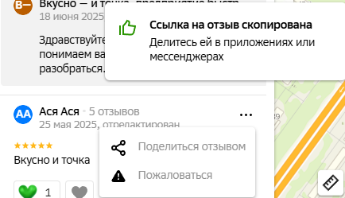

# **Парсер отзывов с 2GIS**

Этот проект предназначен для сбора и анализа отзывов с платформы 2GIS.


## **Установка и запуск**

1. Установите Python 3.13+
2. Клонируйте репозиторий:
   ```sh
   git clone https://github.com/for-what-or/2gis-parser.git
   cd 2gis-parser
   ```
3. Создайте и активируйте виртуальное окружение:
   ```sh
   python -m venv venv
   # Для Windows:
   venv\Scripts\activate
   # Для Linux/MacOS:
   source venv/bin/activate
   ```
4. Установите зависимости:
   ```sh
   pip install -r requirements.txt
   playwright install
   ```
5. Создайте и настройте переменные окружения в файле `.env`:
   ```ini
   BRANCH_URLS=https://2gis.ru/ufa/firm/12345/tab/reviews,https://2gis.ru/ufa/firm/67890/tab/reviews
   TG_BOT_TOKEN=токен_телеграм_бота
   TG_CHAT_ID=айди_телеграм_чата
   ```
6. Запустите парсер:
   ```sh
   python main.py
   ```
   ВНИМАНИЕ! Абсолютно ВСЕ новые отзывы будут отправляться в прописанный в ```.env``` телеграм чат.


## Сборка и запуск докер образа:
### Сборка:
```sh
docker build -t 2gis-parser .
```
### Запуск:
```sh
docker run --env-file .env 2gis-parser
```
ВНИМАНИЕ! Абсолютно ВСЕ новые отзывы будут отправляться в прописанный в ```.env``` телеграм чат.

## Чтобы проверить наличие отзыва в базе:

Выполните следующую команду:
```sh
python review_test.py
```
И вставьте ссылку на отзыв, скопировавшуюся после нажатия кнопки поделиться отзывом


## **Разработчик: Калямов Ильфат**

**Контакты**:
- [Telegram](https://t.me/for_what_or)
- [VK](https://vk.com/for_what_or)